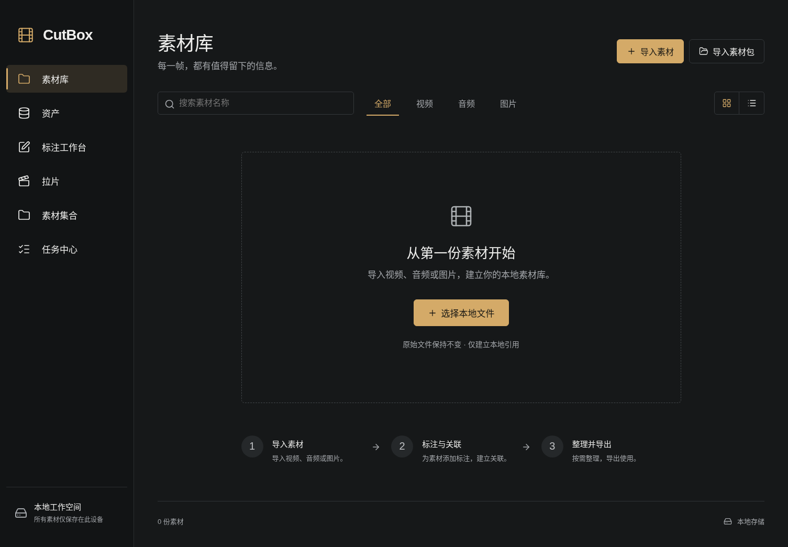

<!-- bip:project:start -->
# CutBox

本地优先的影视素材标注、拉片与素材集合制作工具。

[English](README.md)

**当前为 Electron 0.2 开发预览版。** 从本地视频、图片和音频出发，建立角色、场景、道具、声音资产，记录时间段与矩形区域标注，组织素材集合并导出加密描述。



## 启动

需要 Node.js 22.16+（推荐 Node 24 LTS）、npm，以及 PATH 中可调用的 `ffmpeg` / `ffprobe`。macOS 可执行 `brew install ffmpeg` 安装媒体工具。

```sh
npm ci
npm start
```

技术栈为 Electron、React/TypeScript、SQLite 和隔离的后台 Worker；无需云账号或 API Key。普通导入只建立本地引用，请保留原始文件位置；素材包导入会复制已校验的媒体到应用管理目录。数据保存在 Electron 应用数据目录，可通过 `CUTBOX_DATA_DIR` 指定；`CUTBOX_FFMPEG` / `CUTBOX_FFPROBE` 可指定工具路径。

## 0.2 可用能力

- **素材与资产**：角色／演员／场景／道具／声音，跨剧集信息、类型化属性、批量入集合和播放清单。
- **精细标注**：自定义字段模板、观察／解释／虚构、置信度与审核；画面拖拽框选、多边形、关键帧轨迹。
- **时间与检索**：多轨时间线、区间循环、源帧时间索引、证据跳转、组合筛选和视觉相似候选。
- **故事游戏化**：事件、证据关系、状态变化；变量、节点、条件、选择与效果；可试玩分支和图诊断。
- **本地分析**：镜头切分、音频波形、OCR、光流跟踪、HOG 人体检测，结果先进入人工审核。
- **参考工坊**：片段、边缘、固定／跟随裁切、PNG 帧、WAV 音频，以及整批导出。
- **本地模型**：MiDaS 深度、MediaPipe 姿态与蒙版；另支持配置本地 Depth Anything 和 faster-whisper。
- **交换与恢复**：完整／裁剪 `.cbox` 集合、JSONL/SRT/COCO、故事 JSON/RenPy/Godot、原片重新定位、代理、备份恢复、跨重启撤销重做与任务历史。

模型功能需要独立的 Python 环境与本地权重，见[本地模型安装](docs/LOCAL_MODELS.md)。推理过程中不会自动下载权重；依赖缺失会明确显示原因。转写适配器已实现，本环境尚无 faster-whisper 权重，未验证真实语音转写。视觉相似与检测／跟踪结果需要人工判断，不能视为角色身份确认。

已在 Linux 运行真实 Electron、FFmpeg 和部分 CPU 模型验证。macOS 为首要产品目标；macOS/Windows 原生验收、签名与安装包尚未完成。源帧索引帮助定位，但浏览器 seek、VFR、旋转、HDR 与重编码输出尚无统一逐帧精确保证。

**`.cbox` 只加密描述，外部素材为明文；项目备份和训练格式导出也为明文。** 桌面格式 `cutbox.desktop/0.2` 可导入 0.1；与 Python 实验格式不同。请携带完整集合目录。RenPy/Godot 适配器导出叙事逻辑，媒体需在目标引擎中另行连接。

历史默认保留 30 次元数据快照；大库性能、多说话人分离、自动身份重识别、完整多次派生链与深度时序质量尚未验证。详见[验证与能力边界](docs/VALIDATION.md)。

## 设计与验证

[产品目标](specs/VISION.md) · [开源调研](docs/research/RESEARCH.md) · [交互设计](docs/INTERACTION.md) · [数据模型](docs/DATA_MODEL.md) · [架构](docs/ARCHITECTURE.md) · [CBox 格式](docs/CBOX_FORMAT.md) · [路线图](docs/ROADMAP.md) · [验证记录](docs/VALIDATION.md)

[参考视频设计](docs/REFERENCE_EXPORT.md)与[角色／场景资产工作区](docs/ASSET_WORKSPACE.md)包含后续完整目标，具体可用范围以上述清单为准。

```sh
npm run check
npm run test:desktop:all  # 需要图形显示环境，Linux CI 可使用 Xvfb
```

`npm run dev` 仅预览渲染页面；本地文件功能需 Electron。修改界面后运行 `npm run build`，再用 `npm run desktop` 启动。早期 Python 格式实验及其测试入口见英文 README。
<!-- bip:project:end -->

## 造物矩阵

欢迎到 [造物矩阵](https://zaowujuzhen.com/about) 交流创作与实践。已有的 [GitHub 月度会员礼物入口](https://zaowujuzhen.com/prime?plan=monthly&discount=GITHUB) 使用兑换码 `GITHUB`；当前权益与可用性以兑换页面为准，本轮未验证兑换结果。

<!-- bip:creator:start -->
## 关于作者

你好，我是 **Cell 细胞**。我写代码，也写文章，把好奇心做成作品，探索更自主的工作与生活。

- [个人站 · cellinlab.com](https://cellinlab.com/)：作品、文章与联系入口。
- [造物矩阵](https://zaowujuzhen.com/about)：连接正在创造的人、作品与实践；公开创作记录、会员内容与交流是其中的一部分。
- [X · @cellinlab](https://x.com/cellinlab)：公开探索和开发进展。

扫码加我微信，备注 **GitHub** 就行。点击图片可查看原图。

<table>
  <tr>
    <td align="center" width="33%"><a href="public/wetouch/wechat.webp"></a><br>个人微信</td>
    <td align="center" width="33%"><a href="public/wetouch/wechat-channels.webp"></a><br>视频号</td>
    <td align="center" width="33%"><a href="public/wetouch/wechat-official.webp"></a><br>公众号 · Cell 细胞呀</td>
  </tr>
</table>

## 赞助

如果这些项目对你有帮助，也欢迎支持我的持续探索。

<table>
  <tr>
    <td align="center" width="50%"><br>支付宝</td>
    <td align="center" width="50%"><br>微信赞赏</td>
  </tr>
</table>
<!-- bip:creator:end -->

## License

[MIT](LICENSE). Based on [vibecoding-bip-template](https://github.com/cellinlab/vibecoding-bip-template); original license and creator assets retained.
