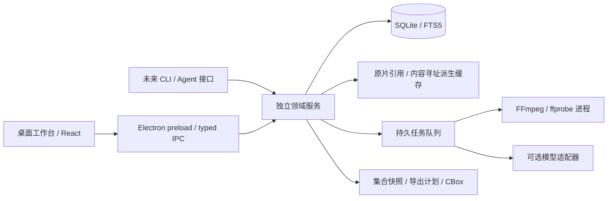

# 架构与技术决策

状态：Electron 0.3 开发预览。当前验证在 Linux；模型或合成样本测试不能替代 macOS／Windows 真机、安装包和硬件性能验收。当前实现、已验收与后续目标分别记录，测试证据见[验证记录](VALIDATION.md)。

## 当前实际实现

| 模块 | 文件 | 已实现职责与边界 |
| --- | --- | --- |
| 桌面主进程 | `desktop/main.mjs`、`desktop/preload.cjs` | 原生选择器、窄 IPC、按入库媒体 ID 提供源／代理文件流；sandbox、contextIsolation、禁止 Node 集成与任意导航 |
| 界面 | `src/` | 资产、模板、标注、集合、故事、制作准备、数据集检查／检索、模型工具与任务记录 |
| 后台协调 | `desktop/backend-worker.mjs` | Node Worker 独占领域数据库，协调媒体／模型子进程、导入与导出；长任务可取消，关闭时等待收尾 |
| 领域存储 | `desktop/domain.mjs` | SQLite WAL、schema v3、九类对象、v1／v2 迁移、全图校验和事务、有界快照历史；Map 索引减少引用校验中的重复线性查找 |
| 基础媒体 | `desktop/media.mjs` | 探测、摘要、缩略图、原片／边缘／裁剪／帧／音频输出；外部 FFmpeg 与 ffprobe 必须可用 |
| 媒体分析 | `desktop/media-tools.mjs` | 镜头切分建议、波形、帧时间索引与代理；音画共享时间原点，避免独立归零抹掉声画起始偏移 |
| 字幕 | `desktop/subtitles.mjs` | UTF-8 SRT／WebVTT 解析、偏移、范围检查、文本净化和说话人标签；批量事务入库为待审核，置信度未知；字幕排版不导入 |
| 本地推理 | `desktop/models.mjs`、Python worker | OCR、HOG、光流、深度、姿态、蒙版、转写适配器与模型设置；缺少本地依赖／权重不伪造结果 |
| 检索 | `desktop/search.mjs`、`desktop/discovery-index.mjs` | 组合筛选、视觉候选；独立 SQLite FTS5 trigram 缓存提供分页，短词回退子串扫描 |
| 故事 | `desktop/story.mjs` | 类型化图校验、条件／原子效果、可丢弃预演、结构诊断与外部叙事交换；不执行用户代码、不回写原片观察 |
| 制作准备 | `desktop/production.mjs`、`desktop/production-export.mjs` | 项目／镜头检查、证据整理提示词、五套模板、takes 与选用输出；导出设定集、镜头清单、参考与总览图，仅本地人工交接 |
| 训练数据准备 | `desktop/dataset-preparation.mjs` | 质量／筛选检查、按已知来源／剧集／实体成组划分、带原始与重基准标注的 JSONL、报告与数据集卡 |
| 交换 | `desktop/packages.mjs`、`desktop/portable.mjs` | `.cbox` 0.3 全图交换、0.1／0.2／0.3 导入、完整／裁剪媒体、托管导入；JSONL／COCO／SRT 明文适配 |
| 恢复 | `desktop/reliability.mjs` | 媒体缺失／摘要检查、含媒体的验证备份、恢复、新目录发布与模型配置；重新关联要求原内容身份匹配 |

## 进程、文件与时间

本地数据默认位于 Electron `userData`。普通导入引用原文件，包导入复制到托管目录。数据库在后台 Node Worker，FFmpeg／Python 运行于独立子进程；Worker 与 Electron 主进程共享同一进程地址空间，不是数据库进程级隔离。渲染器只发送类型化命令和媒体 ID，文件位置来自原生选择器或经过验证的导入，不获得任意 shell 能力。

播放器使用 Chromium `<video>/<audio>`；不能播放的编码可生成代理。探测器按容器／流共同起点计算时长，帧索引同时返回源时间与相对共同起点的时间。FFmpeg 导出与代理保持各流相对 PTS，波形和音频导出可补齐延迟音轨起始空白。以上修复特定容器起点和延迟音频问题，**不等于完整整数 PTS／音频样本编辑模型**，也不保证任意 VFR、HDR、旋转或多轨媒体的逐帧重建。

重新关联要求完整 SHA-256／大小匹配；同内容重新导入可修复失效位置。备份复制校验后的媒体和领域快照，恢复经 `replaceSnapshot` 事务处理，不裸拷运行中的 WAL 文件。缓存与托管媒体的自动垃圾回收仍未实现。

## 检索和规模边界

`cutbox.sqlite` 是领域数据源；`discovery.sqlite` 是可重建缓存，包含搜索文档、结构化索引与 FTS5 trigram 表。首次检索或相关写操作使缓存失效后，后台从当前完整快照重建。长度至少三个字符的查询词使用 trigram 召回，所有词再按字面子串检查；较短词包含短中文词，使用子串回退。条件与标签按 AND 组合，返回 `items/total/limit/offset/hasMore`，不把查询输入当作任意 SQL／FTS 表达式执行。

分页减少单次检索返回量，Map 查找减少领域引用校验开销；但 App 仍接收完整图快照，写入仍克隆、校验与持久化完整元数据图。默认保存 30 次操作前后快照（可配置 1–200），不是永久审计账本。10,000 条合成标注测试覆盖部分查找、导入与分组逻辑，**不是端到端大库流式架构或长片性能保证**。向量索引、增量索引更新、对象级订阅与完全虚拟化列表仍未实现。

## 制作与数据集交接

制作项目保存镜头、实体／证据引用、连续性与当前需求；每条 take 保存绑定媒体、平台／模型、实际提交提示词快照、字符串 seed、外部任务 ID 与本地记录时间。`outputMediaId` 单独记录当前选用结果。制作资料包是明文：设定集 JSON／Markdown、镜头 CSV、提示词、参考帧／音频／可选片段、最多前 32 份视觉参考的总览图、候选输出、审阅报告与文件摘要。引用别名仅标识本地文件，不是厂商 API 参数。

Seedance／SeeDance、LibTV、TapNow 当前只用于人工交接标签，不连接账户、不上传、不调用生成接口。工业流程一手资料与无法核实的平台信息见[制作调研](research/PRODUCTION_PIPELINE.md)和 [AIGC 工作流](AIGC_WORKFLOW.md)；没有声称实现 OTIO、OpenAssetIO、USD、OCIO 或 IMF。

训练准备的元数据检查不访问文件；实际导出再校验素材摘要。所有分组方式都合并已知同源内容／裁剪祖先，剧集／实体模式增加保守连接；种子决定可复现分配，比例是目标而非固定配额。行记录同时保留原始标注与导出后时间重基准标注。生产计划和 takes 图不混入训练快照。具体谱系歧义、空分组与格式边界见[数据集准备](DATASET_PREPARATION.md)。

## 可选模型与可靠输出

本轮实际使用过 MiDaS 深度、MediaPipe 姿态／分割及 OCR、HOG、光流。faster-whisper 与 Depth Anything 的指定本地权重路径尚未端到端验证。模型可用性来自本机检测，不能由适配器存在推断质量、实时速度或 macOS GPU 支持。

长任务传播取消和子进程失败，输出先写 staging，校验后发布到未占用位置。素材包、制作包和数据集输出均不覆盖现有目录。媒体复制与数据库提交不是同一原子事务，失败清理由协调层承担；任务记录不等于可恢复执行的持久调度队列。

### 实际服务接口

- 领域：`createDomain`、`validateSnapshot`、九类对象 CRUD、`importSnapshot`、`replaceSnapshot`、`undo/redo/history`。
- 媒体／字幕：`importMedia`、`probeMedia`、`exportReference`、`detectScenes`、`waveform`、`frameTimestamps`、`createProxy`、`parseSubtitles`。
- 发现：`createDiscoveryIndex().replace/search`；桥接 `discoverAnnotations`。
- 制作：`auditProduction`、`draftShotPrompt`、`exportProductionKit`；五套模板由显式安装命令添加。
- 数据集：`inspectDataset`、`splitDataset`、`exportTrainingDataset`。
- 交换／恢复：`exportBundle/importBundle`、`exportDataset`、`backupProject/readBackup`。

后端路径参数由主进程对话框和服务校验提供。序列化细节见[数据模型](DATA_MODEL.md)与[CBox 格式](CBOX_FORMAT.md)。

以下是不应与当前完成状态混淆的长期架构目标。

## 目标不变量

1. 原片只读，来源身份由完整内容哈希标识；文件路径只是位置。
2. 标注与解释分离，人工确认与模型建议分离。
3. 任一裁切、重采样、分离、转录、翻译与嵌入都有输入版本、工具版本、参数、输出哈希。
4. 时间、坐标和音轨必须可还原；搜索结果、导出、重新导入引用同一领域对象。
5. 无模型、无网络时仍能导入、手工标注、组集和导出。
6. 加密不能替代来源可信度、使用许可或质量审核。

## 目标组件边界

领域服务唯一拥有数据库写权限。前端只发送类型化命令、订阅修订事件；模型 worker 只提交候选，不能直接改人工标注。所有路径与进程启动由后端验证，前端没有任意 shell 权限。当前媒体访问限定为已入库记录所引用的文件，路径来自本机文件选择或验证后的包导入；服务不监听公网。

## 后续技术路线与替代方案

| 层 | 首选 | 原因与代价 | 何时换方案 |
| --- | --- | --- | --- |
| 桌面壳 | Electron（用户已选择） | Chromium行为一致、前端开发与调试工具成熟；包体积与基础资源占用较高 | 先验证媒体闭环；Tauri仅保留为备选，不在首版同时维护两套壳 |
| UI | TypeScript + React + Vite，虚拟化列表，Canvas/WebGL 覆盖层 | 时间线、轨迹和波形大量可见元素；领域状态通过修订号协调 | 不引入完整视频编辑器框架；复杂状态可用 reducer/state machine |
| 数据 | SQLite WAL + FTS5，类型化迁移 | 本地事务、关系查询、备份与全文检索足够；图用节点与边表表达 | 向量规模实际测量后再用 sqlite-vec / 独立索引；初期不部署图数据库或向量服务 |
| 媒体 | FFmpeg / ffprobe，隔离进程 | 探测、代理、抽帧、音轨拆分、精确导出；记录构建信息 | 硬解、HDR与复杂播放需求驱动原生播放器扩展 |
| 播放 | 首版代理视频播放 + 后端精确帧预览 | 快速建立界面；播放不是时间真源。逐帧选择使用解码出的源 PTS 和帧图像，不能从 `currentTime * fps` 算帧号 | macOS AVFoundation 桥接作为精确播放候选；libmpv 提供跨平台候选，需渲染嵌入和许可试验 |
| 推理 | 独立 Python/原生进程适配器，按功能安装 | 不把 PyTorch、模型与 CUDA 打包成每个用户必装项；崩溃/OOM不带走主界面 | 常用模型经测量再移植 ONNX/Core ML；不假设 MPS 可运行所有 CUDA 项目 |
| 转录 | macOS 优先评估 whisper.cpp；WhisperX 为对齐适配器候选 | 前者有 Apple Silicon 支持资料；后者提供对齐和 diarization 组合 | 需自有中英混说、配乐、电影对白样本；README 速度不是本机承诺 |
| 封装 | 独立协议模块（语言待验证）；已有 Python 协议实验与 Node 桌面协议实现（schema 不互通） | AEAD 认证加密、标准库路径与哈希检查；协议跨语言 | 正式版本冻结前做双实现测试向量和安全评审 |

SwiftUI + AVFoundation 能更深使用 macOS 媒体能力，但 Windows/Linux UI 重做成本高。PySide6 + libmpv 利于 Python 推理开发，但发布体积、依赖隔离和复杂 UI 维护需要验证。Electron 的运行时一致性有价值，却不能自动解决 H.265/HDR、精确求帧和本机模型部署。用户已选择首版使用Electron；媒体与推理性能仍需单独验证。

## 尚待完成的精确时间与空间模型

- 每个 stream 保存容器 stream index、time_base 分子分母、start_pts、duration、旋转矩阵、像素宽高、SAR/DAR、色彩信息。
- 源时间保存整数 PTS + 有理 time_base，音频区间保存 sample_start/sample_end 与采样率。半开区间 `[start,end)`；不得把显示时间码作为唯一键。
- 切片输出的新时间轴通过 transform 记录回源映射；音频预滚、编解码延迟、重采样和视频旋转都要记录。
- 代理视频附 source↔proxy PTS 映射。VFR、重帧、丢帧时不能假定恒定 fps；镜头索引与解码帧索引是不同概念。
- 坐标存于定义好的原始显示方向画布，归一化矩形/多边形、关键点或外部 mask blob；明确 pixel aspect、裁切、缩放的转换矩阵。
- “无损快切”和“精确切片”是两个导出模式。流拷贝受关键帧限制，显示实际边界；精确切片重新编码并验证首尾帧和音频采样。

## 后续数据布局与性能目标

库目录建议包含 `library.sqlite`、`blobs/sha256/`、`cache/`、`jobs/`、`backups/`；源片默认引用，用户可选择托管拷贝。移盘后按大小、候选路径及完整哈希重新关联，不因同名文件自动绑定。

导入先探测并可浏览；完整哈希、代理、波形、镜头建议渐进执行。哈希未完成的对象标 provisional，不允许正式组集快照。大文件流式处理，模型按镜头/窗口执行；缓存按源哈希、模型版本、参数摘要寻址。UI 不加载全片所有 mask；只加载当前可见时间窗和缩略图层级。

任务状态 queued/running/cancel_requested/succeeded/failed/interrupted。幂等键包含输入修订；断点与临时输出独立，成功后原子替换。取消终止子进程组，失败保留诊断；重启识别中断任务，不以文件存在判成功。GPU任务默认单并发，CPU预算可调。下载模型前显示大小、来源、许可证和磁盘预算，校验摘要。

## 后续编辑与恢复目标

领域命令以事务写入当前对象与审计记录；长期目标是让撤销也可永久审计；当前 undo/redo 移动有界历史游标，新分支会丢弃 redo 记录。当前已采用 SQLite 当前表 + 有界 revision log；永久审计和长任务修订冲突检测仍是后续目标，不建立全量 event-sourcing 系统。长任务完成时检查输入修订，过时结果保留为建议而不覆盖人工修改。备份使用 SQLite backup API，不裸拷正在写入的 WAL 数据库。

导出先生成不可变 collection snapshot，再计算物化计划：成员、源范围、派生策略、预计体积、未审标注、授权缺口、去重关系、目标任务。全部完成并核对哈希才发布最终文件名。磁盘不足或取消只留下明确的 staging，不产生看似可用的集合。

## 需要试验才能决定的事

1. 60分钟 VFR、HEVC、旋转手机素材的定位正确性、内存和首次可用时间。
2. 原生 AVFoundation 与代理+精确帧通道的键盘逐帧体验，跨音轨同步。
3. Apple Silicon 16 GB 上 ASR、检测、分割的峰值内存、实际速度和取消恢复；并不预填“实时”。
4. 10万对象与100万标注的分页查询、时间线交互与备份；公开测量数据后设产品性能承诺。
5. FFmpeg 与播放器最终构建的编解码器、动态链接方式和许可，macOS 签名、公证与模型 worker 启动。

## Electron进程边界

Renderer启用sandbox与contextIsolation、关闭nodeIntegration；preload仅暴露窄类型化API，校验IPC发送者、参数和权限。主进程处理窗口与授权，当前数据库在后台 Node Worker，媒体运行于子进程；推理使用独立 Python 子进程。禁止任意shell、远程页面获得Node权限；限制导航、外链与文件协议访问。SQLite单写入者，协议与领域逻辑可由CLI复用。原生模块按Electron ABI与目标架构打包验证。

新增需求见[参考视频导出](REFERENCE_EXPORT.md)和[资产工作区](ASSET_WORKSPACE.md)。
