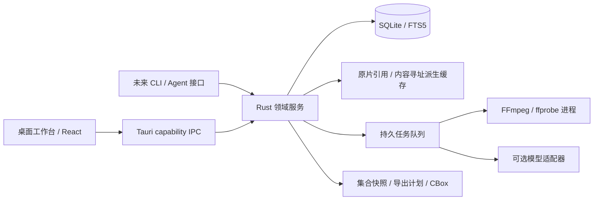

# 架构与技术决策

状态：提案；基础库与格式实验不构成桌面性能验证。

## 不变量

1. 原片只读，来源身份由完整内容哈希标识；文件路径只是位置。
2. 标注与解释分离，人工确认与模型建议分离。
3. 任一裁切、重采样、分离、转录、翻译与嵌入都有输入版本、工具版本、参数、输出哈希。
4. 时间、坐标和音轨必须可还原；搜索结果、导出、重新导入引用同一领域对象。
5. 无模型、无网络时仍能导入、手工标注、组集和导出。
6. 加密不能替代来源可信度、使用许可或质量审核。

## 组件边界

领域服务唯一拥有数据库写权限。前端只发送类型化命令、订阅修订事件；模型 worker 只提交候选，不能直接改人工标注。所有路径与进程启动由后端验证，前端没有任意 shell 权限。媒体访问限定在用户选择的库目录，服务不监听公网。

## 推荐技术栈与替代方案

| 层 | 首选 | 原因与代价 | 何时换方案 |
| --- | --- | --- | --- |
| 桌面壳 | Tauri 2 | Rust 边界、系统 WebView；少带一个浏览器运行时，但 WebView 媒体能力跨平台不一致 | 若嵌入播放器与打包原型成本明显超标，比较 Electron；不靠包体积直接定输赢 |
| UI | TypeScript + React + Vite，虚拟化列表，Canvas/WebGL 覆盖层 | 时间线、轨迹和波形大量可见元素；领域状态通过修订号协调 | 不引入完整视频编辑器框架；复杂状态可用 reducer/state machine |
| 数据 | SQLite WAL + FTS5，Rust 类型化迁移 | 本地事务、关系查询、备份与全文检索足够；图用节点与边表表达 | 向量规模实际测量后再用 sqlite-vec / 独立索引；初期不部署图数据库或向量服务 |
| 媒体 | FFmpeg / ffprobe，隔离进程 | 探测、代理、抽帧、音轨拆分、精确导出；记录构建信息 | 硬解、HDR与复杂播放需求驱动原生播放器扩展 |
| 播放 | 首版代理视频播放 + 后端精确帧预览 | 快速建立界面；播放不是时间真源。逐帧选择使用解码出的源 PTS 和帧图像，不能从 `currentTime * fps` 算帧号 | macOS AVFoundation 桥接作为精确播放候选；libmpv 提供跨平台候选，需渲染嵌入和许可试验 |
| 推理 | 独立 Python/原生进程适配器，按功能安装 | 不把 PyTorch、模型与 CUDA 打包成每个用户必装项；崩溃/OOM不带走主界面 | 常用模型经测量再移植 ONNX/Core ML；不假设 MPS 可运行所有 CUDA 项目 |
| 转录 | macOS 优先评估 whisper.cpp；WhisperX 为对齐适配器候选 | 前者有 Apple Silicon 支持资料；后者提供对齐和 diarization 组合 | 需自有中英混说、配乐、电影对白样本；README 速度不是本机承诺 |
| 封装 | Rust 正式实现；本轮 Python 协议实验 | AEAD 认证加密、标准库路径与哈希检查；协议跨语言 | 正式版本冻结前做双实现测试向量和安全评审 |

SwiftUI + AVFoundation 能更深使用 macOS 媒体能力，但 Windows/Linux UI 重做成本高。PySide6 + libmpv 利于 Python 推理开发，但发布体积、依赖隔离和复杂 UI 维护需要验证。Electron 的运行时一致性有价值，却不能自动解决 H.265/HDR、精确求帧和本机模型部署。选择 Tauri 是当前可逆提案，不是已实测的最终结论。

## 时间与空间

- 每个 stream 保存容器 stream index、time_base 分子分母、start_pts、duration、旋转矩阵、像素宽高、SAR/DAR、色彩信息。
- 源时间保存整数 PTS + 有理 time_base，音频区间保存 sample_start/sample_end 与采样率。半开区间 `[start,end)`；不得把显示时间码作为唯一键。
- 切片输出的新时间轴通过 transform 记录回源映射；音频预滚、编解码延迟、重采样和视频旋转都要记录。
- 代理视频附 source↔proxy PTS 映射。VFR、重帧、丢帧时不能假定恒定 fps；镜头索引与解码帧索引是不同概念。
- 坐标存于定义好的原始显示方向画布，归一化矩形/多边形、关键点或外部 mask blob；明确 pixel aspect、裁切、缩放的转换矩阵。
- “无损快切”和“精确切片”是两个导出模式。流拷贝受关键帧限制，显示实际边界；精确切片重新编码并验证首尾帧和音频采样。

## 数据布局与性能

库目录建议包含 `library.sqlite`、`blobs/sha256/`、`cache/`、`jobs/`、`backups/`；源片默认引用，用户可选择托管拷贝。移盘后按大小、候选路径及完整哈希重新关联，不因同名文件自动绑定。

导入先探测并可浏览；完整哈希、代理、波形、镜头建议渐进执行。哈希未完成的对象标 provisional，不允许正式组集快照。大文件流式处理，模型按镜头/窗口执行；缓存按源哈希、模型版本、参数摘要寻址。UI 不加载全片所有 mask；只加载当前可见时间窗和缩略图层级。

任务状态 queued/running/cancel_requested/succeeded/failed/interrupted。幂等键包含输入修订；断点与临时输出独立，成功后原子替换。取消终止子进程组，失败保留诊断；重启识别中断任务，不以文件存在判成功。GPU任务默认单并发，CPU预算可调。下载模型前显示大小、来源、许可证和磁盘预算，校验摘要。

## 编辑与恢复

领域命令以事务写入当前对象与审计记录；undo 是新修订，不删除历史。先以 SQLite 当前表 + revision log 实现，不建立全量 event-sourcing 系统。长任务完成时检查输入修订，过时结果保留为建议而不覆盖人工修改。备份使用 SQLite backup API，不裸拷正在写入的 WAL 数据库。

导出先生成不可变 collection snapshot，再计算物化计划：成员、源范围、派生策略、预计体积、未审标注、授权缺口、去重关系、目标任务。全部完成并核对哈希才发布最终文件名。磁盘不足或取消只留下明确的 staging，不产生看似可用的集合。

## 需要试验才能决定的事

1. 60分钟 VFR、HEVC、旋转手机素材的定位正确性、内存和首次可用时间。
2. 原生 AVFoundation 与代理+精确帧通道的键盘逐帧体验，跨音轨同步。
3. Apple Silicon 16 GB 上 ASR、检测、分割的峰值内存、实际速度和取消恢复；并不预填“实时”。
4. 10万对象与100万标注的分页查询、时间线交互与备份；公开测量数据后设产品性能承诺。
5. FFmpeg 与播放器最终构建的编解码器、动态链接方式和许可，macOS 签名、公证与模型 worker 启动。
